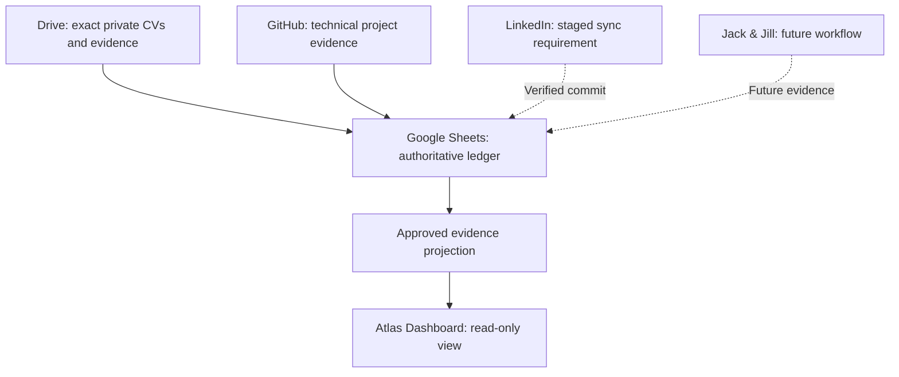

# Atlas Dashboard Evidence Architecture

Authored reference as of **25 October 2026**, documenting the current source and integration boundaries. This is a design/source-boundary document, not a copied private image, recovered v53 implementation or production connection receipt.

| Boundary | Required behaviour | Public implementation |
|---|---|---|
| Sheets | Authoritative ledger with explicit accepted updates | No connection or ledger data included |
| Drive | Preserve exact original CV/evidence files and their provenance | No private documents or identifiers included |
| GitHub | Technical source/design evidence bound to real revisions | Public six-project registry with scoped receipts |
| Dashboard | Consume a projection; show unavailable data honestly | Projects-only UNCONNECTED viewer |
| LinkedIn | Stage → write → read back → commit | Workflow requirement; no live adapter verified here |
| Jack & Jill | Application workflow | Future work |

## LinkedIn Synchronisation Boundary

Stage the intended update before writing. Perform only the connected-service/platform-authorised write. Read back the written state and compare it with the staged update. Commit accepted ledger/projection state only after that read-back is verified. A failed or uncertain write/read-back must not become a verified completion or published projection.

This sequence describes the required synchronisation contract. The recovered public source has no live LinkedIn writer implementing it. No action or completion is inferred from this diagram.

## Permission Boundary

Read/write permissions and external-action approval belong to the connected service and execution platform. Plugin text may constrain a workflow; it cannot grant provider access, bypass platform approval or authorise itself. The dashboard does not complete approval on another service's behalf.

## Public and Hosted Source Boundary

The public source is a sanitized v47 derivative, using technical metadata only. The current hosted Atlas Dashboard v53 source identity is `f5200fce79b425d6d15d35aafcd9be11aa49fbab`; its source remains unrecovered. Private connectivity is outside the verified scope of this public checkout.

The latest accepted UI direction is teal/silver/black with a speedometer. This public viewer uses the palette and supplies no operational gauge reading. It does not claim visual or functional parity with the hosted dashboard.

See [legacy compatibility](../COMPATIBILITY.md) for stable identifiers retained beneath the current Atlas naming.
