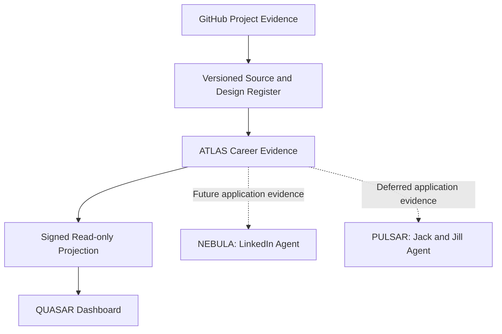

# QUASAR Evidence Architecture

Reference as of **25 October 2026**. This is newly authored documentation based on
the user's ecosystem identities and inspected source boundaries. It is not a copy
of an unavailable Library image or a production deployment receipt.

| Component | Established Evidence | Implementation Boundary |
|---|---|---|
| GitHub Register | Public source revisions, design documents and scoped test receipts | Technical metadata; no CV contents or private application records |
| ATLAS | Ecosystem career-evidence responsibility and integration contract | No production ATLAS implementation repository is claimed here |
| QUASAR | Recovered historical v47 dashboard source; current v49 hosted Site recorded separately | Exact v49 source recovery and operational integration remain unverified |
| NEBULA | LinkedIn application-agent identity | Future build; no live application capability established |
| PULSAR | Jack and Jill recruitment-agent identity | Deferred |

## Public Build

The standalone public build exposes project metadata and this design reference
only. It uses **UNCONNECTED** mode, disables operational API routes and does not
include a signed projection. The diagram describes the intended evidence
relationship; the public build does not claim those connections are operating.

The original v47 architecture presentation is historical source. Where older
naming differs, this dated identity reference governs the current documentation.
AWS targets elsewhere in the portfolio remain explicitly proposed designs.
